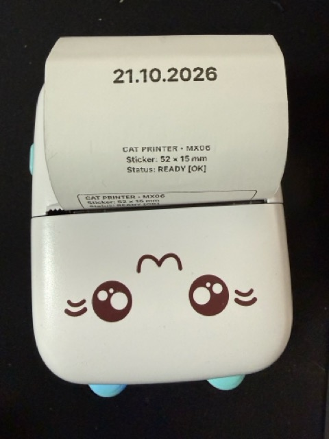

# CatPrint

[](https://github.com/bossly/catprint/actions/workflows/build.yml)
[](https://caniuse.com/web-bluetooth)

<p align="center">
  
</p>

> 🚀 **Live Web Application**: [**https://bossly.github.io/catprint/**](https://bossly.github.io/catprint/)  
> Open directly in **Google Chrome**, **Microsoft Edge**, **Brave**, or **Bluefy** (iOS) to connect and print directly to your Bluetooth thermal printer. Zero app installation and zero servers required!

---

A 100% client-side web application powered by Chrome's **Web Bluetooth API** (`navigator.bluetooth`) to design, preview, and print receipts, stickers, and photos directly to Bluetooth Low Energy (BLE) portable thermal printers.

Zero cloud servers, zero ads, zero tracking, no app install required — print straight from your browser.

---

## 🖨️ Supported Printers & Hardware

CatPrint supports any **58mm / 2-inch** portable BLE thermal printer using the standard **`0x5178` header framing protocol** (384 dots per line at 203 DPI) and primary GATT Service `0000AE30-0000-1000-8000-00805F9B34FB` (or `0xAF30`).

### Verified Compatible Models

| Hardware Family | Model Numbers / Series | Default Advertised BLE Names | Recommended Feed Mode |
| :--- | :--- | :--- | :--- |
| **FunPrint / MX-Series** | `MX05`, `MX06`, `MX08`, `MX09`, `MX10`, `MXTP` | `MX05`, `MX06`, `MX08`, `MX09`, `MX10`, `MXTP`, `FunPrint`, `Fun Print` | **Blank Lines Workaround** *(bypasses firmware feed bug)* |
| **BQ / Q Series** | `BQ05`, `Q5`, `C9`, `C13`, `C15`, `C17` | `BQ05`, `Q5`, `Print...` | Blank Lines Workaround |
| **iPrint & Cat Printers** | `GB01`, `GB02`, `GB03`, `GT01`, `YT01` | `GB01`, `GB02`, `GB03`, `GT01`, `YT01`, `CAT-xxxx` | Hardware Command `0xA1` or Blank Lines |
| **WalkPrint Series** | `WalkPrint`, `X5`, `X6` | `WalkPrint`, `WALK` | Hardware Command `0xA1` or Blank Lines |
| **Generic 58mm BLE Printers** | Any 384-dot thermal printer utilizing `AE30`/`AF30` services | Prefix `PRINT`, `Print`, `BLE_...` | Configurable in UI |

### BLE Technical Specifications
- **Primary GATT Service UUID**: `0000AE30-0000-1000-8000-00805F9B34FB` (fallback: `0000AF30-...`)
- **Write Characteristic UUID**: `0000AE01-0000-1000-8000-00805F9B34FB` (`writeWithoutResponse` required for FunPrint/MX)
- **Notify Characteristic UUID**: `0000AE02-0000-1000-8000-00805F9B34FB`
- **Framing Protocol**: `[0x51, 0x78, cmd, len_low, len_high, payload..., crc8, 0xFF]` (CRC-8 polynomial `0x07`, initial `0x00`)
- **Printhead Geometry**: 384 dots per line (48 bytes per row) @ 203 DPI (8 dots/mm)
- **Media Support**: 57 mm continuous rolls and 50×15 mm, 52×15 mm, 52×30 mm die-cut sticker rolls

---

## 🌐 Browser Compatibility

| Platform | Recommended Browsers | Web Bluetooth Support |
| :--- | :--- | :---: |
| **macOS** | Google Chrome, Microsoft Edge, Brave, Opera | ✅ Full Support |
| **Windows** | Google Chrome, Microsoft Edge, Brave | ✅ Full Support |
| **Linux / ChromeOS** | Google Chrome, Chromium, Brave | ✅ Full Support |
| **Android** | Google Chrome, Samsung Internet | ✅ Full Support |
| **iOS / iPadOS** | [Bluefy Browser](https://apps.apple.com/app/bluefy-web-ble-browser/id1492822055) | ✅ Supported via Bluefy |

*(Note: Safari and Firefox do not currently support the Web Bluetooth API).*

---

## Features

- **100% Client-Side Web Bluetooth App**:
  - Direct connection to BLE thermal printers via `navigator.bluetooth`.
  - Zero server dependencies, no tracking, works completely offline once cached.
- **Label & Receipt Designer**:
  - Live typography editor with instant auto-fit text scaling.
  - Multi-line alignment, font family selection, and bold/invert styling.
  - Quick presets for receipts, date stamps, and test patterns.
- **Photo Dithering Engine**:
  - Drag-and-drop or file upload for photos, logos, and stickers.
  - **Floyd-Steinberg error diffusion dithering** with real-time brightness and contrast sliders.
- **Die-cut Sticker & Continuous Roll Simulation**:
  - Exact 384-dot canvas rendering with printable boundaries, safe margins, and inter-label pitch advance.
  - Presets: 52×15 mm, 50×15 mm, 52×30 mm, 50×30 mm, continuous 57 mm roll, and custom millimeter sizes.
- **Hardware Calibration Controls**:
  - Paper feed mode: Hardware command `0xA1` or **Blank Lines workaround** (required for FunPrint / MX firmware bug).
  - Pre-print retraction steps, post-print feed steps, printhead energy (darkness), and line pacing delay.

---

## Getting Started

### Local Development

```bash
cd web
npm install

# Start local dev server (open in Google Chrome, Edge, or Brave)
npm run dev

# Run TypeScript unit tests (Vitest)
npm test

# Build production bundle (outputs to web/dist/)
npm run build

# Build directly to docs/ for GitHub Pages
npm run build:docs
```

## Printing with Your Printer

1. Power on your thermal printer (e.g. `MX06`, `GB01`, `FunPrint`).
2. Open the [**CatPrint Web App**](https://bossly.github.io/catprint/) in a Web Bluetooth capable browser (**Google Chrome**, **Microsoft Edge**, **Brave**, or **Bluefy** on iOS).
3. Click **Connect to MX06** (or **Choose Printer...** to select your device from the browser prompt).
4. Select your paper media type (Sticker 52×15 mm, 50×15 mm, or Continuous Roll).
5. Compose your text receipt or drop an image into the photo ditherer.
6. Verify the live thermal preview.
7. Click **Print Sticker** / **Print Receipt**. The app sends paced packets over Bluetooth and feeds the paper past the blade.

---

## Privacy & Security

- **Zero Data Collection**: All Bluetooth pairing, text layout, image processing, and packet encoding happen strictly inside your browser session.
- **No Remote Calls**: No external tracking, telemetry, or server communication.
- **Open Protocol**: Fully open-source implementation based on research from [werwolv.net/blog/cat_printer](https://werwolv.net/blog/cat_printer/).
